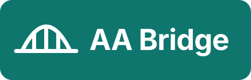
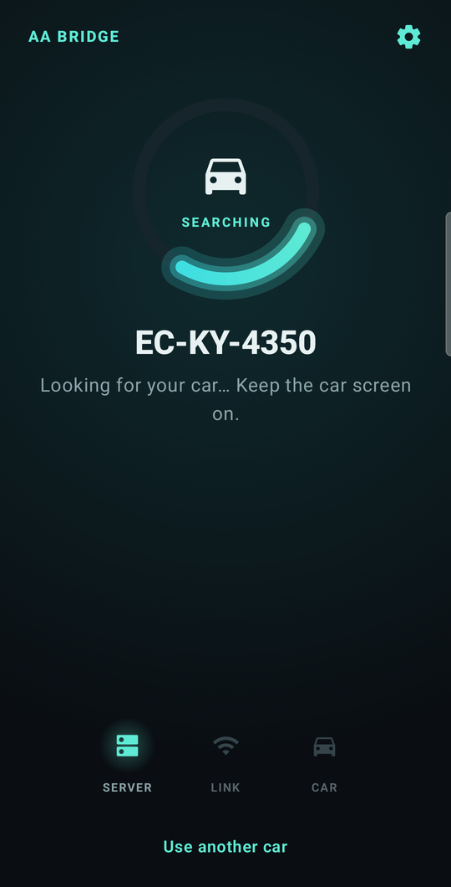

<p align="center">
  
</p>

AA Bridge brings Android Auto to cars whose screen only supports CarbitLink (also called EasyConnection) phone mirroring.

The app runs on your phone. It starts a local Android Auto session and sends it to the car, over a USB cable or wirelessly over Wi-Fi Direct. Touches on the car screen go back to Android Auto.

## Screenshots

<p align="center">
  
  <!-- Still to add from a drive:
       docs/screenshots/home-connected.png  Home while connected
       docs/screenshots/nearby-cars.png     Nearby cars listing the car
       docs/screenshots/car-screen.jpg      photo of the car screen running Android Auto -->
</p>

## Will it work in my car?

- **Tested:** 2026 Geely Emgrand (Egypt, head unit EC-KY-4350), over cable and wireless. One other CarbitLink head unit over cable.
- **Likely to work:** cars from Geely, Chery, Jetour, BAIC, JAC, GAC and Proton whose screen has CarbitLink, EasyConnection or a "phone link" app. This list comes from adapter listings and owner guides, not from our own tests.
- **Tried it in your car?** Open an [issue](../../issues) with the car model and year, the name of the phone-link app on the car screen, cable or wireless, and whether it worked.

## What you need

- An Android 10 or newer phone with Android Auto
- A car whose screen has CarbitLink or EasyConnection
- A USB data cable, or Wi-Fi turned on for wireless

## Download

Get the APK from [Releases](../../releases). Android asks once to allow installs from your browser or chat app.

## Setup

The app walks you through this the first time:

1. Allow notifications, location and the microphone.
2. Turn on Android Auto developer mode: open Android Auto settings and tap Version 10 times.
3. Start Android Auto's server: tap ⋮, then Start head unit server.
4. Connect to your car:
   - **Cable:** plug the phone into the car's USB port, then choose AA Bridge and Always.
   - **Wireless:** tap Connect without a cable, then tap your car. Keep the car screen on the phone-link page.

## Every drive

- **Cable:** plug in. Android Auto opens on the car screen by itself.
- **Wireless:** open AA Bridge. It finds your car and connects. You can close the app after that.

Plugging in the cable while connected wirelessly switches over without restarting Android Auto. Music, navigation voice and calls play through the phone's Bluetooth to the car, so keep the phone paired with the car.

## If something goes wrong

- **"Android Auto needs a tap":** Android Auto's server stops when the phone restarts. Tap the notification, then ⋮ and Start head unit server.
- **Stuck on "Starting…":** go to Settings → Apps → Android Auto → Force stop, then start the server again.
- **Can't find your car:** make sure the car screen is on and showing the phone-link page, Wi-Fi is on, and the phone is close by.

## Known limits

- Android Auto's developer mode is not an official feature, so an Android Auto update can break it.

## Building

Needs JDK 17 and the Android SDK.

```bash
./gradlew assembleDebug
```

## Credits

Based on [CarAALink](https://github.com/JObersi10/CarAALink) by JObersi10. The Android Auto head unit certificate comes from aasdk, see [PROVENANCE.md](app/src/main/assets/aa/PROVENANCE.md).

## License

GPL-3.0, see [LICENSE](LICENSE).

Android Auto is a trademark of Google LLC. AA Bridge is not affiliated with Google or the makers of CarbitLink.
