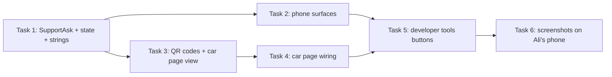

# Support Ask Implementation Plan

> **For agentic workers:** REQUIRED SUB-SKILL: Use superpowers:subagent-driven-development (recommended) or superpowers:executing-plans to implement this plan task-by-task. Steps use checkbox (`- [ ]`) syntax for tracking.

**Goal:** Ask people AA Bridge has helped to support it through InstaPay or PayPal, in Egyptian Arabic, on the phone and once a month on the car screen.

**Architecture:**
- One pure object, `SupportAsk`, holds the links and decides when an ask is due.
- `AppSettings` stores the state.
- The phone surfaces are Compose screens wired through `MainActivity`.
- The car page is a new `CarScreen.SUPPORT` in `CarStatusPresentation`. The service shows it only for a fresh connection.
- Developer tools get two buttons so every surface can be put on screen over adb and screenshotted.

**Tech Stack:** Kotlin, Jetpack Compose (Material 3), Android Presentation API, JUnit 4. No new app dependencies.

**Spec:** `docs/superpowers/specs/2026-11-24-support-ask-design.md`



## Global Constraints

- **Copy:** use the strings below verbatim, in `app/src/main/res/values/strings.xml` with `translatable="false"`, and not in `values-ar`. Arabic shows on every phone, whatever its language:
  - `support_if_helped`: لو الابلكيشن ساعدك واستفدت بيه
  - `support_popup_body`: أنا علي، اللي عامل AA Bridge، وهيفضل مجاني. تقدر تدعمه بتمن فنجان قهوة، مثلاً 100 جنيه، أو بأي مبلغ يريحك. ومفيش أي إلزام، ودعوة حلوة منك تفرق معايا زيها زي أي مبلغ.
  - `support_action`: ادعم AA Bridge
  - `support_not_now`: مش دلوقتي
  - `support_already`: دعمت قبل كده
  - `support_thanks`: شكرًا إنك دعمت AA Bridge.
  - `support_banner`: لو الابلكيشن ساعدك، ادعمه بتمن فنجان قهوة
  - `support_amount_hint`: اكتب المبلغ اللي يريحك، مثلاً 100 جنيه
  - `support_instapay`: InstaPay (داخل مصر)
  - `support_paypal`: PayPal (خارج مصر)
  - `car_support_line`: ادعمه بتمن فنجان قهوة، مثلاً 100 جنيه
  - `car_support_open_aa`: افتح Android Auto
- **Links, exact:** `https://ipn.eg/S/alimorgaan/instapay/4NfOYd` and `https://paypal.me/alimorgaan`.
- **Layout direction:** the banner, the pop-up, the Support screen and the car page are laid out right to left on every phone. The Settings row follows the Settings list.
- **Digits:** amounts use Western digits (`100`).
- **Never use:** «تبرع», «صدقة», «ادعموني», user counts, «أجر», «ثواب».
- **Interval:** 30 days is `30L * 24 * 60 * 60 * 1000` ms. The pop-up and the car page each keep their own clock. Each clock is set when its surface is shown.
- **QR codes:** dark modules on a white square with a 4-module quiet zone, error correction M, encoding the https links above.
- **Car page and Android Auto:** the car page never shows on top of Android Auto and never opens Android Auto by itself.
- **Code comments:** at most 2 lines.
- **Commit messages:** plain sentences in the repo's style. No co-author and no AI attribution.
- **Build environment:** `JAVA_HOME=/usr/lib/jvm/java-17-openjdk-amd64 ANDROID_HOME=$HOME/Android/Sdk`, abbreviated below as `ENV`.

## Review Focus

1. **Phone clock moved backwards** after an ask was shown (`now < lastShownAt`): the ask counts as due instead of staying silent until the old time comes back. Task 1 test.
2. **Tapping «دعمت قبل كده»** hides the banner at once, without restarting the app. Task 6, shot 06.
3. **Reconnects in the middle of a drive** never show the car page. Only the two user-started paths pass `fresh = true`. Task 4, grep step.
4. **The car page while it is on screen:** nothing reopens Android Auto by itself. Task 4 test on `mayAutoOpenAa`.
5. **A launch from the car's USB attach** never shows the phone pop-up. Task 6, shot 07.
6. **The car QR codes scan:** each decodes to its exact link from the screenshot. Task 6, decode step.

---

### Task 1: SupportAsk, state and strings

**Rung:** new code. Nothing in the app decides asks today. Storage reuses `AppSettings`.

**Files:**
- Create: `app/src/main/kotlin/dev/caraalink/support/SupportAsk.kt`
- Modify: `app/src/main/kotlin/dev/caraalink/settings/AppSettings.kt`, after `setCarConnectedOnce`
- Modify: `app/src/main/res/values/strings.xml`, adding the 12 strings from Global Constraints
- Test: `app/src/test/kotlin/dev/caraalink/support/SupportAskTest.kt`

**Interfaces:**
- Produces:
  - `SupportAsk.INSTAPAY_URL: String` and `SupportAsk.PAYPAL_URL: String`
  - `SupportAsk.INTERVAL_MS: Long`
  - `SupportAsk.isDue(helped: Boolean, supported: Boolean, lastShownAt: Long, now: Long): Boolean`
  - `AppSettings.supportHelped(ctx): Boolean` and `setSupportHelped(ctx)`, key `support_helped`
  - `AppSettings.supported(ctx): Boolean` and `setSupported(ctx)`, key `support_supported`
  - `AppSettings.supportPopupShownAt(ctx): Long` and `setSupportPopupShownAt(ctx, at: Long)`, key `support_popup_shown_at`, default 0
  - `AppSettings.supportCarPageShownAt(ctx): Long` and `setSupportCarPageShownAt(ctx, at: Long)`, key `support_car_page_shown_at`, default 0
  - `AppSettings.resetSupportAsks(ctx)`: helped=true, supported=false, both clocks 0

- [ ] **Step 0: Commit the spec and this plan**

```bash
git add docs/superpowers/specs/2026-11-24-support-ask-design.md docs/superpowers/plans/2026-11-24-support-ask.md
git commit -m "Add the support ask design and plan"
```

- [ ] **Step 1: Write the failing test**

```kotlin
package dev.caraalink.support

class SupportAskTest {
    private val day = 24L * 60 * 60 * 1000
    private val now = 1_000 * day

    @Test
    fun dueOnlyForHelpedNonSupportersEveryThirtyDays() {
        assertTrue(SupportAsk.isDue(helped = true, supported = false, lastShownAt = 0, now = now))
        assertFalse(SupportAsk.isDue(helped = false, supported = false, lastShownAt = 0, now = now))
        assertFalse(SupportAsk.isDue(helped = true, supported = true, lastShownAt = 0, now = now))
        assertFalse(SupportAsk.isDue(helped = true, supported = false, lastShownAt = now - 30 * day + 1, now = now))
        assertTrue(SupportAsk.isDue(helped = true, supported = false, lastShownAt = now - 30 * day, now = now))
    }

    @Test
    fun aClockMovedBackwardsStillAsks() {
        assertTrue(SupportAsk.isDue(helped = true, supported = false, lastShownAt = now + 5 * day, now = now))
    }
}
```

- [ ] **Step 2: Run it to confirm it fails**

Run: `ENV ./gradlew :app:testDebugUnitTest --tests 'dev.caraalink.support.SupportAskTest'`
Expected: compilation fails with "Unresolved reference: SupportAsk".

- [ ] **Step 3: Implement `SupportAsk` and the `AppSettings` functions above, and add the 12 strings**

`isDue` returns true when `helped && !supported` and one of these holds: `lastShownAt == 0`, `now < lastShownAt`, or `now - lastShownAt >= INTERVAL_MS`.

- [ ] **Step 4: Run the test, then the whole suite**

Run: `ENV ./gradlew testDebugUnitTest`
Expected: `BUILD SUCCESSFUL`, with `SupportAskTest` passing.

- [ ] **Step 5: Commit**

```bash
git add app/src/main/kotlin/dev/caraalink/support app/src/test/kotlin/dev/caraalink/support app/src/main/kotlin/dev/caraalink/settings/AppSettings.kt app/src/main/res/values/strings.xml
git commit -m "Add the support ask state, links and copy"
```

### Task 2: Phone surfaces

**Rung:** reuses the existing pieces: `SubScreen`, `GlowButton`, `DashLink`, `SettingsRow`, the `Screen` routing and `LocalUriHandler`. The Compose layouts are new code.

**Files:**
- Create: `app/src/main/kotlin/dev/caraalink/ui/SupportScreen.kt`
- Create: `app/src/main/res/drawable/ic_coffee.xml`, the Material "local_cafe" 24dp vector
- Modify: `app/src/main/kotlin/dev/caraalink/MainActivity.kt`, at the `Screen` enum, the `back` lambda, the `when (screen)` block and `onStart`
- Modify: `app/src/main/kotlin/dev/caraalink/ui/HomeScreen.kt:129`, the signature, plus the banner under `DashTopBar`
- Modify: `app/src/main/kotlin/dev/caraalink/ui/SettingsScreen.kt:70,121`, adding the row and a subtitle on `SettingsRow`

**Interfaces:**
- Consumes: everything Task 1 produces.
- Produces:
  - `Screen.SUPPORT`
  - `@Composable fun SupportScreen(onBack: () -> Unit, onSupported: () -> Unit)`
  - `@Composable fun SupportDialog(onSupport: () -> Unit, onDismiss: () -> Unit, onSupported: () -> Unit)`
  - `@Composable fun SupportBanner(onClick: () -> Unit)`
  - `HomeScreen(onOpenSettings, onOpenNearby, showSupportBanner: Boolean, onOpenSupport: () -> Unit)`
  - `SettingsScreen(onBack, onHelp, onAbout, onSupport: () -> Unit)`

- [ ] **Step 1: Write `SupportScreen.kt`**

Wrap all three composables in `CompositionLocalProvider(LocalLayoutDirection provides LayoutDirection.Rtl)`.

- `SupportScreen` uses `SubScreen(stringResource(R.string.support_action), onBack)`, containing:
  - the `support_amount_hint` text
  - a `GlowButton` for `support_instapay` that opens `SupportAsk.INSTAPAY_URL`
  - a `GlowButton` for `support_paypal` that opens `SupportAsk.PAYPAL_URL`
  - a `DashLink` for `support_already` that calls `onSupported`
- `SupportDialog` is a Material 3 `Dialog` with:
  - the `support_if_helped` title and the `support_popup_body` text
  - three stacked full-width buttons: `support_action` → `onSupport`, `support_not_now` → `onDismiss`, `support_already` → `onSupported`
- `SupportBanner` is a full-width rounded row in the Dash teal accent, with `ic_coffee` and the `support_banner` text.

- [ ] **Step 2: Wire `MainActivity`**

Add `SUPPORT` to `Screen`. Add these activity fields:

```kotlin
private var supportBanner by mutableStateOf(false)
private var supportPopup by mutableStateOf(false)
```

In `onStart`:
- Set `supportBanner = helped && !supported`.
- If the launch wasn't by the car and `SupportAsk.isDue(..., supportPopupShownAt, now)` is true, set `supportPopup = true` and call `setSupportPopupShownAt(now)`. "By the car" means `intent?.action == ACTION_USB_ACCESSORY_ATTACHED` and `FLAG_ACTIVITY_LAUNCHED_FROM_HISTORY` not set.

Define one `onSupported` lambda that:
1. calls `AppSettings.setSupported(this)`
2. sets `supportBanner = false` and `supportPopup = false`
3. shows `Toast(support_thanks)`
4. leaves the Support screen if it is open

Show `SupportDialog` at the top of `setContent` while `supportPopup` is true. Its `onSupport` closes the dialog and opens `Screen.SUPPORT`. Make `back` return SUPPORT to SETTINGS when `fromSettings` is set, as it does for HELP and ABOUT.

- [ ] **Step 3: Wire `HomeScreen` and `SettingsScreen`**

- `HomeScreen`: when `showSupportBanner` is true, render `SupportBanner(onOpenSupport)` directly under `DashTopBar`, with horizontal padding of 20.dp.
- `SettingsRow`: gets `supporting: String? = null`, passed to `ListItem.supportingContent`.
- `SettingsScreen`: add `SettingsRow(painterResource(R.drawable.ic_coffee), stringResource(R.string.support_action), onSupport, supporting = stringResource(R.string.support_if_helped))` directly above the About row.

- [ ] **Step 4: Build**

Run: `ENV ./gradlew :app:assembleDebug testDebugUnitTest`
Expected: `BUILD SUCCESSFUL`. The screens are checked visually in Task 6.

- [ ] **Step 5: Commit**

```bash
git add app/src/main/kotlin/dev/caraalink/ui app/src/main/kotlin/dev/caraalink/MainActivity.kt app/src/main/res/drawable/ic_coffee.xml
git commit -m "Ask for support on the phone: banner, monthly pop-up, Settings row"
```

### Task 3: QR codes and the car page view

**Rung:** new code. The QR codes are generated once into vector drawables, so the app gets no QR library.

**Files:**
- Create: `app/src/main/res/drawable/qr_instapay.xml` and `app/src/main/res/drawable/qr_paypal.xml`
- Modify: `app/src/main/kotlin/dev/caraalink/video/CarStatusPresentation.kt:21`, the enum, plus the `onCreate` branch

**Interfaces:**
- Produces: `CarScreen.SUPPORT`. `CarStatusPresentation(context, display, CarScreen.SUPPORT, onOpenAa)` renders the car page.

- [ ] **Step 1: Generate the two QR drawables and confirm they decode**

Run this throwaway script with `S` set to the scratchpad directory. It is not committed.

```bash
python3 -m venv "$S/qrenv" && "$S/qrenv/bin/pip" install -q segno opencv-python-headless
"$S/qrenv/bin/python" -I - "$S" <<'PY'
import segno, sys
S, out = sys.argv[1], "app/src/main/res/drawable/"
for name, url in [("qr_instapay", "https://ipn.eg/S/alimorgaan/instapay/4NfOYd"), ("qr_paypal", "https://paypal.me/alimorgaan")]:
    q = segno.make(url, error="m", micro=False)
    rows = list(q.matrix_iter(scale=1, border=4))
    n = len(rows)
    dark = "".join(f"M{x},{y}h1v1h-1z" for y, r in enumerate(rows) for x, v in enumerate(r) if v)
    open(out + name + ".xml", "w").write(
        f'<!-- {url}, error correction M. Regenerate if the link changes. -->\n'
        f'<vector xmlns:android="http://schemas.android.com/apk/res/android" android:width="{n * 4}dp" android:height="{n * 4}dp" '
        f'android:viewportWidth="{n}" android:viewportHeight="{n}">\n'
        f'  <path android:fillColor="#FFFFFF" android:pathData="M0,0h{n}v{n}h-{n}z"/>\n'
        f'  <path android:fillColor="#000000" android:pathData="{dark}"/>\n</vector>\n')
    q.save(f"{S}/{name}.png", scale=10, border=4)
PY
"$S/qrenv/bin/python" -I -c "import cv2,sys;d=cv2.QRCodeDetector();[print(d.detectAndDecode(cv2.imread(sys.argv[1]+'/'+p+'.png'))[0]) for p in ('qr_instapay','qr_paypal')]" "$S"
```

Expected output: the two exact URLs, one per line.

- [ ] **Step 2: Add `SUPPORT` to `CarScreen` and its branch to `CarStatusPresentation.onCreate`**

- The root `FrameLayout` uses `layoutDirection = View.LAYOUT_DIRECTION_RTL`.
- It holds a horizontal row:
  - **Right (start in RTL):** a vertical text block with `support_if_helped` (30f, bold, TEXT), `car_support_line` (20f, MUTED), then a button in the style of `openButton()` labeled `car_support_open_aa` that calls `onOpenAa`.
  - **Left (end in RTL):** two QR blocks, each an `ImageView` of 150dp × 150dp with `qr_instapay` or `qr_paypal`, captioned `support_instapay` or `support_paypal` (16f, MUTED).
- The `title` mapping in `onCreate` must cover SUPPORT, because `when` is exhaustive.

- [ ] **Step 3: Build**

Run: `ENV ./gradlew :app:assembleDebug`
Expected: `BUILD SUCCESSFUL`.

- [ ] **Step 4: Commit**

```bash
git add app/src/main/res/drawable/qr_instapay.xml app/src/main/res/drawable/qr_paypal.xml app/src/main/kotlin/dev/caraalink/video/CarStatusPresentation.kt
git commit -m "Add the car support page with InstaPay and PayPal QR codes"
```

### Task 4: Car page wiring

**Rung:** reuses the existing pieces: the once-per-session auto-open point, `mayAutoOpenAa` and the AA watchdog tick. The `fresh` flag is new.

**Files:**
- Modify: `app/src/main/kotlin/dev/caraalink/link/CarSession.kt` at the constructor (line 23), the `autoLaunchedAa` block (around line 428), the `aaWatchdogTick` AA branch, and `mayAutoOpenAa` (line 583)
- Modify: `app/src/main/kotlin/dev/caraalink/service/UsbLinkForegroundService.kt` at the START_SESSION branch (line 147), `beginSession`, `beginWireless` and `startWirelessSession`
- Test: `app/src/test/kotlin/dev/caraalink/link/CarSessionWatchdogTest.kt:11`

**Interfaces:**
- Consumes: `CarScreen.SUPPORT` (Task 3), plus `SupportAsk.isDue` and the `AppSettings` support functions (Task 1).
- Produces:
  - `CarSession(context, accessory, keepAndroidAuto = false, showSupportPage: Boolean = false, onEnded)`
  - `beginSession(accessory, fresh: Boolean = false)` and `startWirelessSession(fresh: Boolean = false)`

- [ ] **Step 1: Write the failing assertion**

Add to `releasedOrClosedNeverReopensByItself`:

```kotlin
assertFalse(CarSession.mayAutoOpenAa(released = false, screen = CarScreen.SUPPORT))
```

- [ ] **Step 2: Run it to confirm it fails**

Run: `ENV ./gradlew :app:testDebugUnitTest --tests 'dev.caraalink.link.CarSessionWatchdogTest'`
Expected: FAIL in `releasedOrClosedNeverReopensByItself`.

- [ ] **Step 3: Implement**

- **`mayAutoOpenAa`:** `!released && screen != CLOSED && screen != SUPPORT`.
- **The `autoLaunchedAa` block:** if `showSupportPage`, call `AppSettings.setSupportCarPageShownAt(context, now)` and `display.showStatus(CarScreen.SUPPORT)`. Otherwise call `openAndroidAuto()` as today.
- **`aaWatchdogTick`:** on the first tick with `display.mode == Mode.AA && probe.hasReceivedVideo`, call `AppSettings.setSupportHelped(context)` once per session, guarded by a field.
- **Service:**
  - The START_SESSION branch calls `beginSession(accessory, fresh = true)`.
  - `beginWireless` calls `startWirelessSession(fresh = true)`.
  - Every other call site keeps the default `false`.
  - Both builders pass `showSupportPage = fresh && dev.caraalink.aa.AaSessionProbe.active == null && SupportAsk.isDue(helped, supported, carPageShownAt, now)`.

- [ ] **Step 4: Run all tests**

Run: `ENV ./gradlew testDebugUnitTest`
Expected: `BUILD SUCCESSFUL`.

- [ ] **Step 5: Check that only user-started paths pass `fresh = true`**

Run: `grep -n "fresh = true" app/src/main/kotlin/dev/caraalink/service/UsbLinkForegroundService.kt`
Expected: exactly two lines, in the START_SESSION branch and in `beginWireless`.

- [ ] **Step 6: Commit**

```bash
git add app/src/main/kotlin/dev/caraalink/link/CarSession.kt app/src/main/kotlin/dev/caraalink/service/UsbLinkForegroundService.kt app/src/test/kotlin/dev/caraalink/link/CarSessionWatchdogTest.kt
git commit -m "Show the car support page once a month on a fresh connection"
```

### Task 5: Developer tools buttons

**Rung:** reuses `DeveloperToolsActivity.button(...)` and Android's "Simulate secondary displays", so there's no fake display code.

**Files:**
- Modify: `app/src/main/kotlin/dev/caraalink/diagnostics/DeveloperToolsActivity.kt:52`, after "Connection diagnostics"

- [ ] **Step 1: Add two buttons**

- **"Reset support asks"** calls `AppSettings.resetSupportAsks(this)` and shows the toast "Support asks reset".
- **"Show car support page"** takes the first display from `getSystemService(DisplayManager::class.java).getDisplays(DisplayManager.DISPLAY_CATEGORY_PRESENTATION)`.
  - If there is one, it shows `CarStatusPresentation(this, it, CarScreen.SUPPORT) { presentation.dismiss() }`. The presentation dismisses itself when tapped.
  - If there isn't, it shows the toast "Turn on Developer options → Simulate secondary displays".

- [ ] **Step 2: Build**

Run: `ENV ./gradlew :app:assembleDebug testDebugUnitTest`
Expected: `BUILD SUCCESSFUL`.

- [ ] **Step 3: Commit**

```bash
git add app/src/main/kotlin/dev/caraalink/diagnostics/DeveloperToolsActivity.kt
git commit -m "Add developer tools to reset support asks and preview the car page"
```

### Task 6: Screenshots of everything on Ali's phone

**Rung:** reuses adb, `uiautomator dump` for tap coordinates, `screencap`, and the Task 3 decode venv.

Use the phone over adb (Samsung SM-A256E). Install a release-signed build over the current one, so app data is kept. Save every shot as `$S/shots/NN-name.png`. Find tap targets with `adb shell uiautomator dump /sdcard/ui.xml && adb exec-out cat /sdcard/ui.xml`, matching on the visible text, then tap with `adb shell input tap X Y`.

- [ ] **Step 1: Build and install**

Run: `ENV ./gradlew :app:assembleRelease && adb install -r app/build/outputs/apk/release/app-release.apk`
Expected: `Success`.

- [ ] **Step 2: Reset the asks**

Settings → Advanced → Developer tools → "Reset support asks". Expected: the toast "Support asks reset".

- [ ] **Step 3: Shots 01 to 03**

1. Force-stop and relaunch (`adb shell am force-stop io.github.alimorgaan.aabridge; adb shell monkey -p io.github.alimorgaan.aabridge -c android.intent.category.LAUNCHER 1`). Expect the pop-up over Home. Take `01-popup.png`.
2. Tap «مش دلوقتي». Expect Home with the banner at the top. Take `02-home-banner.png`.
3. Tap the banner. Expect the Support screen. Take `03-support-screen.png`.

- [ ] **Step 4: Shot 04, the InstaPay button**

Tap «InstaPay (داخل مصر)». Expect InstaPay or the browser to open the ipn.eg page for alimorgaan. Take `04-instapay-opened.png`, then press back. Don't send money.

- [ ] **Step 5: Shot 05, the Settings row**

Open Settings. Take `05-settings-row.png`. The row reads «ادعم AA Bridge», with the subtitle «لو الابلكيشن ساعدك واستفدت بيه», above About.

- [ ] **Step 6: Shot 06, after «دعمت قبل كده»**

1. Reset the asks again.
2. Relaunch, then tap «دعمت قبل كده» in the pop-up.
3. Take `06-after-supported.png`. Expect the thanks toast, and Home with no banner, without a restart.

- [ ] **Step 7: Shot 07, a car-attach launch shows no pop-up**

1. Reset the asks again.
2. Force-stop, then run `adb shell am start -a android.hardware.usb.action.USB_ACCESSORY_ATTACHED -n io.github.alimorgaan.aabridge/dev.caraalink.MainActivity`.
3. Take `07-car-launch-no-popup.png`. Expect Home with the banner and no pop-up.

- [ ] **Step 8: Shot 08, the car page**

1. Run `adb shell settings put global overlay_display_devices 1024x536/160`.
2. Developer tools → "Show car support page".
3. Take `08-car-page.png`. The overlay window sits on top of the phone screen.

- [ ] **Step 9: Decode both QR codes from shot 08**

Run: `"$S/qrenv/bin/python" -I -c "import cv2;d=cv2.QRCodeDetector();print(d.detectAndDecodeMulti(cv2.imread('$S/shots/08-car-page.png'))[1])"`
Expected: both exact URLs. If they don't decode, the QR size on the car page is too small. Go back to Task 3 Step 2.

- [ ] **Step 10: Shot 09, then clean up**

1. Take `09-developer-tools.png` showing the two new buttons.
2. Run `adb shell settings delete global overlay_display_devices`.

- [ ] **Step 11: Show Ali every shot**

Embed each PNG in the reply by its absolute path, with one line on what it shows. Point out anything that differs from the spec.

## Unresolved questions

None.
