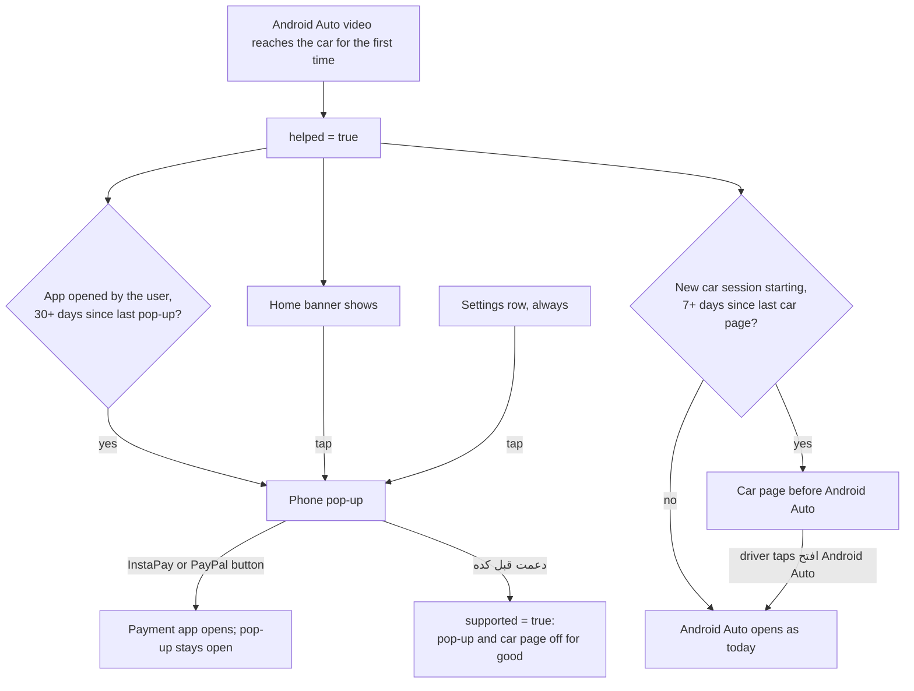

# Support ask ("buy me a coffee") design

## Why

AA Bridge passed 9,600 downloads in its first two weeks, far more than Ali expected. Most users came from Egyptian Facebook car groups. Ali wants people the app helped to be able to support him, through InstaPay (Egypt) and PayPal (outside Egypt).

## Goals

- People whose car Android Auto actually works for are asked, in Egyptian Arabic, to support the app, with the framing "if the app helped you".
- One tap reaches InstaPay or PayPal.
- Anyone who says they already supported is never asked again.

## Non-goals

- Checking whether a payment happened. InstaPay and PayPal don't tell the app, so "I already supported" is taken on trust.
- Analytics or tracking of any kind.
- A README section, a GitHub Sponsor button, asks in the update notice or the connection notification, and Facebook posts. All were dropped.

## Anti-goals

These count as failure even if everything works:

- Anything shown on top of Android Auto while it is on the car screen.
- Wording that reads as begging or charity: «تبرع», «صدقة», «ادعموني», user counts, or religious reward («أجر», «ثواب»).
- Asking someone Android Auto never worked for.
- Asking someone who tapped «دعمت قبل كده» again.

## Constraints

- An InstaPay link or QR fills in the recipient but not the amount, so the suggested amounts (50 or 100 EGP) are printed in the copy. InstaPay doesn't support pasting an address, so it's the link and its QR only.
- InstaPay only works for Egyptian bank accounts. PayPal is the route for everyone else. PayPal is reportedly unavailable or restricted in Tunisia and Algeria.
- Car-screen text must be readable at a glance, with nothing animated or scrolling.
- The app currently has no QR code library.

## Approaches considered

| Option | What it does | Trade-off |
|---|---|---|
| O1 Quiet | Settings row, README, Sponsor button. Nothing pops up. | Annoys no one, but almost nobody sees it. A passive button converts close to zero. |
| O2 Ask once after it works | O1, plus one home-screen card after the 3rd successful connection. | Polite, but Ali wants more reach than a single ask. |
| O3 Always visible | A permanent home-screen button. | Most visible, can feel like nagging. |

**Picked:** a mix that Ali chose:
- a Settings row
- a permanent, eye-catching home banner
- a phone pop-up once a month
- a car-screen page before Android Auto, with no auto-continue: monthly at first, then weekly (Ali's call), because drivers who never open the app are only asked there

The research (`reports/Egyptian donation copywriting.md`, local only) recommends a pop-up every 3 to 4 months and the car page 2 to 3 times a year. Ali chose monthly for the pop-up and weekly for the car page, for people who haven't supported. Supporters are never asked again.

## The design

### Who gets asked

- **Helped:** Android Auto video has reached the car at least once, in any earlier session. The banner, the pop-up and the car page all need this.
- **Supported:** the user tapped «دعمت قبل كده». This turns the pop-up and the car page off for good. The banner stays.
- The Settings row always shows.



### State

The state is stored next to the existing settings in `AppSettings`:

| Key | Meaning |
|---|---|
| helped | Android Auto video reached the car once |
| supported | the user tapped «دعمت قبل كده» |
| popupShownAt | when the pop-up last showed |
| carPageShownAt | when the car page last showed |

Each clock is set when its surface is shown, and the two clocks are independent.

### Surfaces

**Settings row:** sits next to «حول التطبيق» and opens the pop-up.
- Label: «ادعم AA Bridge»
- Subtitle: «لو الابلكيشن ساعدك واستفدت بيه»

**Home banner:** an accent-colored banner at the top of the home screen, under the header and above the status ring. It shows once helped and stays for good, even after «دعمت قبل كده» (Ali's call). It opens the pop-up.
- Text: «لو الابلكيشن ساعدك، ادعمه بتمن فنجان قهوة»

```
AA BRIDGE                                 ⚙
Made by Ali Morgan · v1.2.1
┌──────────────────────────────────────────┐
│ ☕ لو الابلكيشن ساعدك، ادعمه بتمن فنجان قهوة │
└──────────────────────────────────────────┘
              ( status ring )
```

**Phone pop-up:** a dialog on the home screen. It shows when all of these are true: helped, not supported, at least 30 days since `popupShownAt` (or never shown), and the app was opened by the user. A launch from the car's USB attach doesn't count, because that happens right as the driver sets off.

Any open the user starts counts, including from Recents or a notification, and including while a wireless car is connecting. Ali chose this because the moment before a drive is when people are most likely to pay.
- Title: «لو الابلكيشن ساعدك واستفدت بيه»
- Body: «أنا علي، اللي عامل AA Bridge، وهيفضل مجاني. تقدر تدعمه بتمن فنجان قهوة، مثلاً 50 أو 100 جنيه، أو بأي مبلغ يريحك. ومفيش أي إلزام، ودعوة حلوة منك تفرق معايا زيها زي أي مبلغ.»
- The banner and the Settings row open the same pop-up, so payment is one tap from all three. There is no separate Support screen: it was one tap too many (Ali's call).
- Buttons:
  - In Egypt, one InstaPay button: InstaPay purple (#552B78) with InstaPay's own white wordmark (from instapay.eg). It opens the InstaPay link.
  - Elsewhere, one PayPal button: PayPal's gold (#FFC439) with PayPal's logo (from paypalobjects.com). It opens the PayPal link.
  - A small «مش في مصر؟» or «في مصر؟» link switches between them, for a wrong guess.
  - "In Egypt" means the SIM's country is Egypt; with no SIM, the network's country; with neither, the `Africa/Cairo` time zone. Not the phone's language: many Egyptians run English.
  - «مش دلوقتي» closes the dialog.
  - «دعمت قبل كده» sets supported and shows «شكرًا إنك دعمت AA Bridge.»
  - The pop-up stays open after the InstaPay or PayPal button, so coming back after paying lands on «دعمت قبل كده».

**Car page:** a new car status screen, `CarScreen.SUPPORT`. At the point where a session opens Android Auto by itself (once per session, `CarSession`, the `autoLaunchedAa` block), show this page instead when all of these are true: helped, not supported, and at least 7 days since `carPageShownAt` (or never shown). Then set `carPageShownAt`. Tapping «افتح Android Auto» opens Android Auto. The page never opens Android Auto by itself, so `mayAutoOpenAa` must treat SUPPORT like CLOSED. It shows on cable and wireless, in every country.

It only shows on a fresh connection: the first `CarSession` after the cable is plugged in or the user starts a wireless connect. Reconnects also build a new `CarSession` and pass through the same point, so the service has to tell `CarSession` whether it is fresh. Those reconnects are:

- a cable transport reconnect (`scheduleTransportReconnect`)
- a wireless reconnect after the link drops (`onGroupLost`)
- a cable session taking over from wireless

The page also never shows while an Android Auto session is already running (`AaSessionProbe.active`). "Helped" only counts if it was set before the current connection started, so a user's first working drive never ends with the page replacing live Android Auto after a reconnect.

*Builder check:* this rule was settled after review. It follows the earlier agreement that the page never interrupts a drive.

```
┌────────────────────────────────────────────────────────┐
│ ┌───────────┐            لو الابلكيشن ساعدك واستفدت بيه │
│ │ InstaPay  │      ادعمه بتمن فنجان قهوة، مثلاً 50 أو 100 جنيه │
│ │ QR card   │                                          │
│ └───────────┘                  [ افتح Android Auto ]    │
└────────────────────────────────────────────────────────┘
```

### Language

All ask copy is Arabic, whatever language the phone is set to. Many Egyptians run their phones in English, and Ali wants the ask in Arabic. These surfaces are laid out right to left even on an English phone. Amounts use Western digits («100»).

### Links and QR codes

The InstaPay link (Ali has it) and the PayPal link (Ali will create it) are constants in the code, like the About screen's URLs. The car page shows one card, picked the same way as the phone button. In Egypt it is InstaPay's own QR card for `alimorgangranite@instapay`, exported from the InstaPay app: InstaPay's logo, the handle, and InstaPay's signed link `https://ipn.eg/C/Q/alimorgangranite/instapay?ISIGN=…`. Elsewhere it is a white card with PayPal's logo, a QR code for the PayPal link and `paypal.me/alimorgaan`. On a portrait car screen the card goes under the text. The phone pop-up shows none, because a phone can't scan its own screen.

## Releases

Attach the APK twice to each GitHub release: as `AA-Bridge-<version>.apk`, so a browser download never lands as "AA-Bridge (1).apk" next to an old file, and as `AA-Bridge.apk`, so `releases/latest/download/AA-Bridge.apk` links in the README and on Facebook keep working. The in-app updater takes the first `.apk` asset and saves it as `update.apk`, so it needs no change.

## Left to the builder

- How the QR images are made. Preferred: generate them once from the two links, commit them as drawables, and regenerate when a link changes, with no new dependency.
- Exact layout, sizes and colors, within the existing dashboard palette. Car text is bold and large on a dark background.
- Where "helped" is recorded: the first Android Auto video frame that reaches the car.
- A pure function deciding whether an ask is due (helped, supported, last shown, now), with a unit test covering the 30-day boundary and the supported case.

## Links

- InstaPay: `https://ipn.eg/S/alimorgangranite/instapay/0efSwz`
- PayPal: `https://paypal.me/alimorgaan`

The PayPal QR code is generated from its https link. InstaPay uses its own exported card: its signed link was decoded and opens from any phone's camera. If Ali regenerates the card in InstaPay, replace `instapay_card.webp`.
